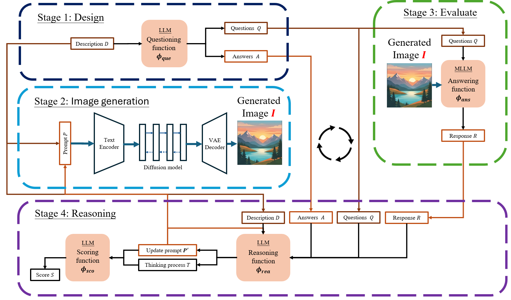

# VSPR: Self-Reasoning Prompt Refinement for Text-to-Image Generation Using Visual Question Answering Feedback

Official implementation of **VQA-guided Self-reasoning Prompt Refinement (VSPR)**.

> Chang-Hsian Ma, Huang-Chia Shih. *Self-Reasoning Prompt Refinement for Text-to-Image Generation Using Visual Question Answering Feedback.* Submitted to Knowledge-Based Systems.

VSPR is a **training-free** automated prompt-engineering method. A multimodal LLM answers a
fixed set of diagnostic VQA questions about every generated image, an LLM reasons over that
feedback to refine the prompt, and the answers also score each round so that the best
prompt–image pair is returned. The text-to-image model stays frozen and nothing is trained or
fine-tuned.



## Method

Given a user description *D* (e.g. "a cat behind a dog"), VSPR runs Algorithm 1 of the paper:

```
P_1 <- D
for i = 1 .. M+1:                                     # initial round + M refinement iterations
    I_i <- G(P_i)                                     # frozen T2I model, batch of B images
    R_i^b <- phi_ans(I_i^b, phi_que(D))               # fixed diagnostic questions on every image
    s_i <- a * DMS_i + (1 - a) * OPS_i                # phi_sco, from the answers (no LLM call)
    if i <= M:
        T_i, P_{i+1} <- phi_rea(D, P_i, feedback(R_i)) # LLM reasoning -> explanation T, refined prompt
return the round with the highest s_i (ties -> the earlier round)
```

| Function | Role | Default model (Ollama) |
|---|---|---|
| φ_que / φ_ans | fixed questions per image: object counts, separate objects, picture-of-object, depth order or occlusion, "Does this image show '*D*'?", one-sentence description; the answers are diagnosed into failure types (missing object, reversed order, fused, …) | `qwen2.5vl:7b` (needs token log-probabilities) |
| φ_rea | reads *D*, the current prompt and the diagnosis of the *B* images, and writes the refined prompt (≤ 60 words) following the "v5" rules: a prompt template, a failure → fix table and six verified examples | `llama3.1:8b` or `deepseek-r1:14b` |
| φ_sco | *s* = *a*·DMS + (1−*a*)·OPS, averaged over the *B* images; *a* = 0.5 | — |
| *G* | SDXL 1.0 base + refiner, or Stable Cascade (via ComfyUI); fixed negative "text, watermark" | — |

* **DMS** (description match score): p(yes | "Does this image show '*D*'?"), read from the
  first answer token's log-probabilities.
* **OPS** (object presence score): P(A present) · P(B present), from the MLLM's distribution
  over the count "0/1/2/3" of each object.

On 360 human-rated images, DMS predicts "matches the description" (AUC 0.88) and OPS predicts
"both objects are present" (AUC 0.82); the combination is best for the first (0.89). The full
description of the questions, the v5 rules and the scores is in [docs/method.md](docs/method.md)
and [docs/scoring.md](docs/scoring.md).

**w/o VQA ablation** (`vspr.use_vqa=false`): no image is inspected; φ_rea sees only *D* and
the current prompt (the same rules, asked to predict the likely failures), and the output is
the last round.

**Fair comparison.** Each description gets a fixed seed derived from the description. The seed
is the same in every round and for every method, so differences come from the prompt alone.
Round 1 of VSPR (*P_1 = D*) is therefore identical to the no-alignment baseline.

## Installation

```bash
conda create -n vspr python=3.11 -y
conda activate vspr
pip install -r requirements.txt            # pipeline (Ollama + ComfyUI clients)
pip install -r requirements-eval.txt       # metrics and HF baselines (installs PyTorch)
```

Install a PyTorch build that matches your CUDA version first if needed
(<https://pytorch.org/get-started/locally/>).

**Ollama** (with the separate `thinking` field and token `logprobs` in the chat API): install from <https://ollama.com>, then

```bash
ollama pull llama3.1:8b
ollama pull deepseek-r1:14b
ollama pull qwen2.5vl:7b
```

**ComfyUI**: install <https://github.com/comfyanonymous/ComfyUI> and put these files in
`ComfyUI/models/checkpoints/`:
`sd_xl_base_1.0.safetensors`, `sd_xl_refiner_1.0.safetensors` (SDXL) and
`stable_cascade_stage_c.safetensors`, `stable_cascade_stage_b.safetensors` (Stable Cascade).
Start it with `python main.py` (default `http://127.0.0.1:8188`). VSPR needs no custom nodes.
It drives the API workflows in [`workflows/`](workflows) and downloads the images itself.

## Quick start

```bash
# 5 descriptions, SDXL + Llama 3.1
python scripts/run_vspr.py --set limit=5 run_name=smoke
```

### Check the scorer on a pilot subset (optional)

φ_sco was validated with qwen2.5vl:7b on SDXL images. With another MLLM or T2I model, check on a
pilot subset that it picks better rounds than not selecting:

```bash
python scripts/run_vspr.py --set limit=100 run_name=sdxl_pilot --export-rounds
python scripts/evaluate.py --eval-root outputs/eval/sdxl --metrics Spatial CS ITM
python scripts/validate_scorer.py --eval-root outputs/eval/sdxl --method vspr_pilot
```

It reports, per metric, round 1 / last round / the round picked by *s*, by DMS alone and by
OPS alone / oracle, plus the rank correlation of each score with the metric. Each run also
writes `provenance.json` with the Ollama version and model digests.

Any config key in [`configs/default.yaml`](configs/default.yaml) can be overridden with
`--set key.sub=value`. Re-running a command resumes from where it stopped.

## Reproducing the experiments

The benchmark is the 3D-spatial subset of T2I-CompBench (1000 descriptions,
[`data/t2i_compbench/3d_spatial.txt`](data/t2i_compbench/3d_spatial.txt)).
[`scripts/reproduce.sh`](scripts/reproduce.sh) / [`scripts/reproduce.ps1`](scripts/reproduce.ps1)
run everything below.

```bash
for T2I in sdxl cascade; do
  for LLM in llama3.1:8b deepseek-r1:14b; do
    python scripts/run_vspr.py --set t2i.backend=$T2I llm.reasoner=$LLM                     # VSPR, iter 1..M
    python scripts/run_vspr.py --set t2i.backend=$T2I llm.reasoner=$LLM vspr.use_vqa=false  # w/o VQA
  done
  python scripts/run_baselines.py --set t2i.backend=$T2I \
      --methods none gpt4 beautiful magic promptist \
      sspo=data/baseline_prompts/sspo.json pag=data/baseline_prompts/pag.json
  python scripts/evaluate.py --eval-root outputs/eval/$T2I \
      --unidet-python /path/to/unidet-env/bin/python
done
python scripts/make_tables.py --eval-root outputs/eval --out outputs/tables.md
```

* `vspr_<llm>` is the best of all *M*+1 rounds by φ_sco (Table 1). `vspr_<llm>_iter<k>` is the
  best of rounds 1..*k*+1 (Table 3), and `iter1` is also the *w/o iterative* ablation (Table 2).
  For `vspr_<llm>_novqa` (*w/o VQA*) there is no φ_sco: it is the last round, and `iter<k>` is
  round *k*+1.
* `gpt4` is the GPT-4o baseline of the paper (`gpt-4o`, the system prompt of the original
  `gpt_prompt_generation.py`). It reads the key from the `OPENAI_API_KEY` environment variable.
* SSPO and PAG have no T2I-ready release. Their prompts are produced with the authors' code and
  imported as a JSON file `{description: prompt}`. The prompts used in the paper are included:
  `data/baseline_prompts/pag.json` and `data/baseline_prompts/sspo.json` (the `description`
  field of the SSPO outputs). Other accepted formats are listed in
  [`vspr/baselines/rewriters.py`](vspr/baselines/rewriters.py).

### Metrics (Section 4.1)

| Key | Metric | Model | Scale in tables |
|---|---|---|---|
| CS | CLIP score, max(100·cos, 0) | CLIP ViT-B/16 | ×1 |
| ITC | BLIP-2 image–text contrastive similarity | `Salesforce/blip2-itm-vit-g` | ×100 |
| ITM | BLIP-2 image–text matching probability | `Salesforce/blip2-itm-vit-g` | ×1000 |
| VQA | p(yes) − p(no), first answer token, for "Does this figure show ‘*D*’?" | BLIP VQA (VQAv2) | ×100 |
| Spatial | UniDet 3D spatial score, 0.25·s₁ + 0.25·s₂ + 0.5·s_loc | UniDet + DPT (T2I-CompBench experts) | ×100 |
| AS | LAION aesthetic predictor v1 (linear head) | CLIP ViT-L/14 | ×10 |

The caption is always the original description *D*. It is read from each method's `manifest.json`,
never inferred from file order (the old evaluation paired `os.listdir` order with the prompt file
and so scored 999 of 1000 prompts against the wrong caption).

**Spatial.** Detection (UniDet, unified label space, threshold 0.5) and depth (DPT) use the
expert models of [T2I-CompBench](https://github.com/Karine-Huang/T2I-CompBench).
Copy `T2I-CompBench/UniDet_eval/experts` (code and `expert_weights/`, about 1.2 GB) into
`VSPR/experts/`, together with `UniDet_eval/dataset/` → `VSPR/dataset/` and `UniDet_eval/datasets/label_spaces/learned_mAP+M.json` → `VSPR/datasets/label_spaces/` (all git-ignored), or pass `--unidet-dir <T2I-CompBench clone>`.
`scripts/unidet_extract.py` runs them in an environment with detectron2 (`--unidet-python`) and
saves boxes and depth maps. spaCy is not needed: objects are parsed from the fixed sentence pattern. The score itself is computed by
[`vspr/eval/spatial.py`](vspr/eval/spatial.py), which fixes problems of both the official script
and the old evaluation:

* explicit object → UniDet label table, with exact matches (no "cat" ↔ "cattle, cow", "bee" ↔ "beer",
  "phone" ↔ "microphone"; "sofa" → couch, "painting" → picture frame, "phone" includes cell phones);
* objects parsed with the dataset grammar instead of spaCy (which mis-tags "key");
* two *different* detections for descriptions like "a microwave in front of a microwave";
* depth map indexed as [y, x] (both earlier implementations used [x, y]);
* "wallet" has no UniDet class: those 41 descriptions are excluded from the mean by default
  (`--spatial-unscorable zero` scores them 0); the number excluded is stored in `metrics.json`.

`--spatial-impl official` runs T2I-CompBench's `3D_spatial_eval.py` unchanged, for comparison
(Linux/WSL only: it splits paths on `/`).

## Output layout

```
outputs/
├─ _image_cache/<backend>/<hash>/{0..B-1}.png       # every generated batch, shared by all runs
├─ vspr/<backend>_<llm>[_novqa]/items/<id>_<slug>/
│   └─ round_<i>/{images,judge,score,reasoning}.json  # G, phi_que/phi_ans, phi_sco, phi_rea
├─ baselines/<method>/prompts.json
└─ eval/<backend>/<method>/
    ├─ samples/<description>_<id:06d>.png           # T2I-CompBench layout
    ├─ manifest.json, scores/<metric>.json, metrics.json
```

Each stage runs over all descriptions before the next one starts, and the models are
unloaded between stages, so only one model has to fit in GPU memory at a time. An RTX 3080
(10 GB) is enough.

## Computational cost

Per description (*M* = 3, *B* = 4; a description with two different objects):

| Calls | Formula | Value |
|---|---|---|
| MLLM (φ_que / φ_ans) | 8 questions · *B* · (*M*+1) | 128 |
| LLM (φ_rea) | *M* | 3 |
| generated images | (*M*+1)·*B* | 16 |

φ_sco uses the MLLM's answers and needs no extra call. Descriptions with the same object twice
("a candle hidden by a candle") need 4 questions per image.

## Repository structure

```
configs/     default configuration
data/        T2I-CompBench 3D-spatial descriptions
workflows/   ComfyUI API workflows (SDXL base+refiner, Stable Cascade C+B)
vspr/        pipeline (judge, prompts, functions, pipeline, llm, comfy), baselines/, eval/
scripts/     run_vspr, run_baselines, evaluate, make_tables, reproduce
docs/        method.md (questions, v5 rules, scores), scoring.md (validation of phi_sco)
tests/       mock end-to-end tests and golden files of the prompts:  pytest
```

## Citation

```bibtex
@article{ma2026vspr,
  title   = {Self-Reasoning Prompt Refinement for Text-to-Image Generation Using Visual Question Answering Feedback},
  author  = {Ma, Chang-Hsian and Shih, Huang-Chia},
  journal = {Knowledge-Based Systems},
  note    = {under review},
  year    = {2026}
}
```

## License

MIT, see [LICENSE](LICENSE). T2I-CompBench, the diffusion models and the language models are
distributed under their own licenses.
